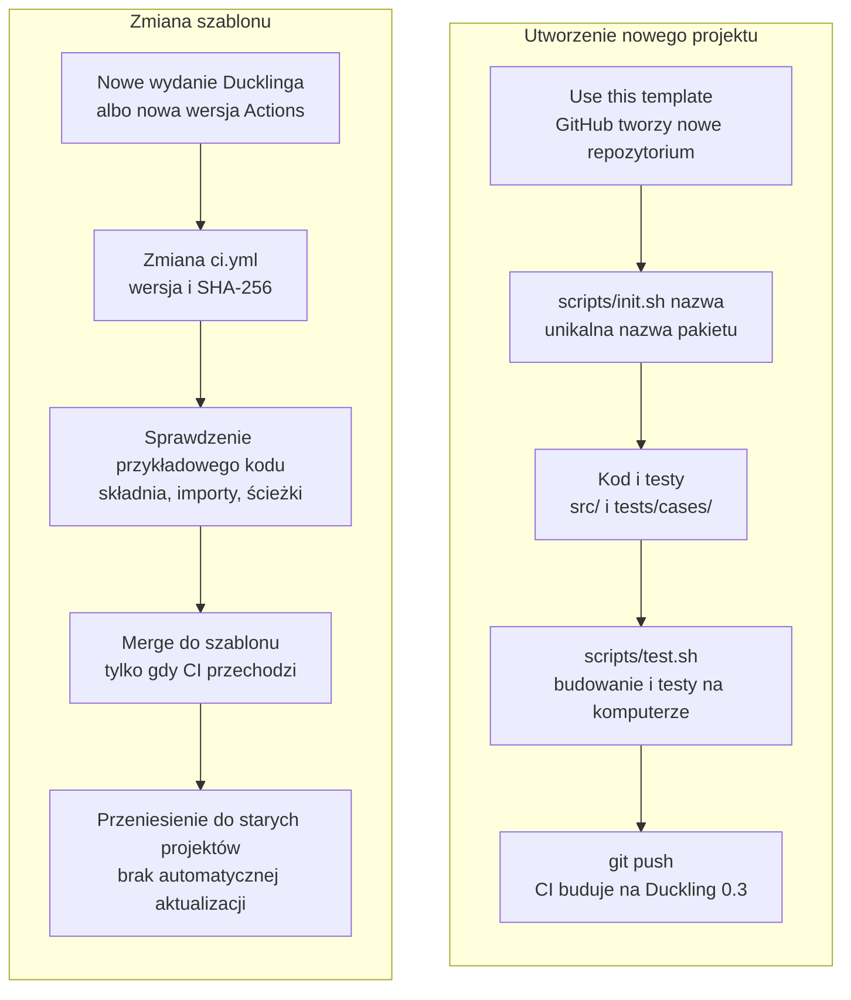

# Szablon repozytorium Duckling: instrukcja użytkownika

Repozytorium szablonu: https://github.com/pixelofsoftware/duckling-template
Język Duckling: https://github.com/ducktype-org/duckling

Tekst jest napisany według zasad ASD-STE100 (Simplified Technical English), przeniesionych na język polski:
krótkie zdania, jedna czynność w jednym kroku, tryb rozkazujący i te same nazwy w całym tekście.

## 1. Opis

Szablon to punkt startowy nowego projektu w Ducklingu. Zawiera pakiet `duck`, przykładowy moduł, testy wyjścia
i workflow CI. Workflow CI buduje projekt oficjalnym wydaniem Ducklinga.

| Element | Funkcja |
|---|---|
| `quackconfig.yaml` | Podaje nazwę i wersję pakietu. |
| `src/src.dk` | Zawiera `fun main()`. Tu program się zaczyna. |
| `src/statystyki.dk` | Przykładowy moduł. Zastąp go własnymi modułami. |
| `tests/cases/*.in`, `*.out` | Jeden przypadek testowy to jeden plik wejścia i jeden plik oczekiwanego wyjścia. |
| `tests/cases/*.code` | Opcjonalny. Podaje oczekiwany kod zakończenia. Domyślnie 0. |
| `scripts/init.sh` | Zmienia nazwę pakietu we wszystkich potrzebnych plikach. |
| `scripts/test.sh` | Buduje pakiet i uruchamia wszystkie przypadki testowe. |
| `.github/workflows/ci.yml` | Pobiera Duckling 0.3, sprawdza sumę SHA-256, buduje i testuje projekt. |
| `.gitattributes` | Oznacza pliki `.dk` i `.dks` jako Duckling dla GitHuba. |
| `README.md` | Zawiera linki do repozytorium Ducklinga, dokumentacji i wydań. |

## 2. Procedura: utwórz nowy projekt

1. Otwórz repozytorium szablonu na GitHubie.
2. Kliknij **Use this template**, potem **Create a new repository**.
3. Sklonuj nowe repozytorium na swój komputer.
4. Uruchom `scripts/init.sh <nazwa>`. Użyj tylko małych liter, cyfr i `_`.
5. Zmień tytuł i opis w `README.md`.
6. Zmień właściciela praw w `LICENSE`.
7. W ustawieniach repozytorium dodaj tematy `duckling` i `duckling-lang`.
8. Uruchom `scripts/test.sh`. Sprawdź, czy wszystkie przypadki testowe pokazują `OK`.

> **UWAGA:** Każda nazwa pakietu musi być unikalna na Twoim komputerze. `duck` trzyma jedno środowisko dla
> każdej nazwy pakietu. Jeśli dwa projekty mają tę samą nazwę, `duck build` zatrzymuje się z komunikatem
> „would overwrite the venv”. Aby przejąć środowisko w bieżącym projekcie, uruchom `duck build --overwrite`.

## 3. Procedura: dodaj moduł

1. Utwórz plik `src/<moduł>.dk`.
2. W `src/src.dk` napisz `import <moduł>;`.
3. W innym module napisz `import <pakiet>.<moduł>;`.

> **INFORMACJA:** Krótka forma `import <moduł>;` działa tylko w `src/src.dk`. W innych modułach krótka forma
> daje błąd „Module not found”.

## 4. Procedura: dodaj przypadek testowy

1. Zapisz wejście programu w `tests/cases/<test>.in`.
2. Zapisz oczekiwane wyjście w `tests/cases/<test>.out`.
3. Jeśli program ma zakończyć się kodem innym niż 0, zapisz ten kod w `tests/cases/<test>.code`.
4. Uruchom `scripts/test.sh`.

Skrypt porównuje wyjście bajt po bajcie. Inna spacja albo inny koniec linii daje błąd.

## 5. Workflow CI

Workflow CI startuje po każdym pushu do `main` i dla każdego pull requestu. Wykonuje te kroki:

1. Pobiera wydanie Ducklinga z repozytorium `ducktype-org/duckling`.
2. Porównuje sumę SHA-256 pliku z wartością w `ci.yml`. Jeśli wartości są różne, workflow się zatrzymuje.
3. Zapisuje toolchain w cache GitHub Actions.
4. Uruchamia `duck build`.
5. Uruchamia `scripts/test.sh --no-build`.

> **INFORMACJA:** Oficjalne wydanie jest dostępne tylko dla Linuksa x86_64. Na innych komputerach zbuduj
> Ducklinga ze źródeł z repozytorium Ducklinga.

## 6. Elementy do zmiany w przyszłości

| Element | Kiedy zmienić | Co zmienić |
|---|---|---|
| Wersja Ducklinga | Gdy DuckType opublikuje nowe wydanie | `DUCKLING_VERSION` i `DUCKLING_SHA256` w `ci.yml` |
| Przykładowy kod w `src/` | Gdy zmieni się składnia albo biblioteki (Duckling jest w fazie alfa) | Importy, funkcje wejścia, składnię |
| Ścieżka programu w `test.sh` | Gdy `duck` zapisze program w innym katalogu | Linię `exe=".duck_build/dev/$name"` |
| Format `quackconfig.yaml` | Gdy `duck init` utworzy inny plik | Pola pliku |
| Kroki instalacji w `README.md` | Gdy zmieni się paczka wydania albo `install.py` | Polecenia w sekcji „Wymagania” |
| Wersje GitHub Actions | Gdy GitHub pokaże ostrzeżenie „deprecated” | `actions/checkout`, `actions/cache` |
| Linki w `README.md` | Gdy dokumentacja Ducklinga zmieni adres | Adresy URL |
| `.gitattributes` | Gdy GitHub Linguist rozpozna Ducklinga | Linie `linguist-language` możesz usunąć. Jeśli zostaną, nie powodują problemów. |

## 7. Procedura: zmień wersję Ducklinga

1. Znajdź nowe wydanie na https://github.com/ducktype-org/duckling/releases.
2. Pobierz plik `duckling-<wersja>-linux-x86_64.tar.gz`.
3. Oblicz sumę kontrolną. Na macOS uruchom `shasum -a 256 <plik>`. Na Linuksie uruchom `sha256sum <plik>`.
4. W `ci.yml` wpisz nowe wartości `DUCKLING_VERSION` i `DUCKLING_SHA256`.
5. Wypchnij zmianę na nową gałąź.
6. Otwórz pull request.
7. Sprawdź, czy workflow CI przechodzi.
8. Zmerguj pull request.
9. Powtórz kroki 4–8 w każdym projekcie utworzonym z szablonu.

> **UWAGA:** GitHub kopiuje szablon tylko raz, gdy tworzy nowe repozytorium. Zmiany w szablonie nie trafiają do
> istniejących projektów. Każdą zmianę musisz przenieść ręcznie do każdego projektu.
